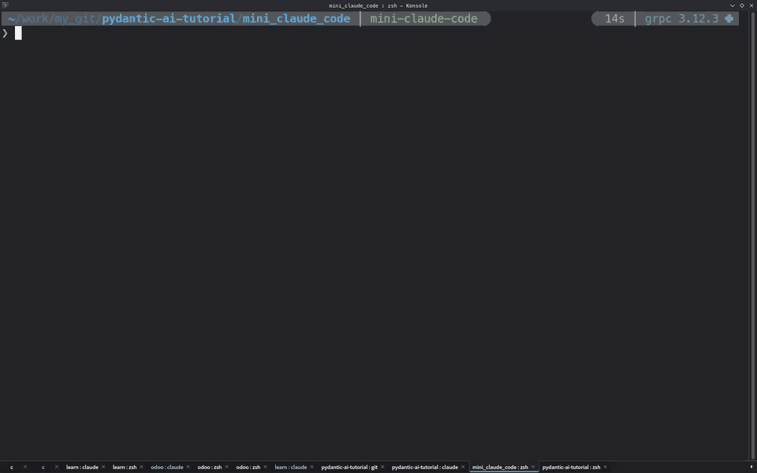
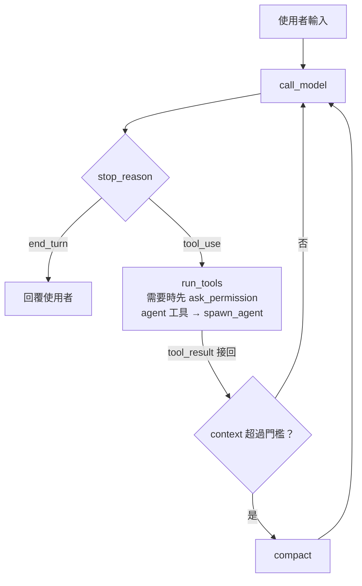

# 迷你 Claude Code：只用 anthropic SDK 手寫 coding agent

[claude_harness_demo.py](../claude_harness_demo.py) 的 Coder 一行就能用，但看不到裡面怎麼跑。這個範例不靠任何 agent 框架，只用 `anthropic` SDK 把 coding agent 的迴圈、工具、快取、compaction、核准、Skills、子代理與網路搜尋手寫一遍，是能實際在專案裡工作的 CLI。預設模型 Claude Haiku。



## 執行

套件見 repo 根目錄 `requirements.txt`，金鑰放根目錄 `.env`（`ANTHROPIC_API_KEY`）。**目前所在目錄就是 agent 的工作目錄**：

```bash
cd ~/my-project
python path/to/mini_claude_code.py                         # 互動模式，/help 看指令
python path/to/mini_claude_code.py "修好 calc.py 的 bug"    # 單次模式
python path/to/mini_claude_code.py --resume                # 接續上次對話
python path/to/mini_claude_code.py --web                   # 開放上網搜尋（另外計費）
python path/to/mini_claude_code.py --model claude-sonnet-5-5 --effort high   # 換模型、思考深度
```

> **安全性**：`bash` 工具能執行任意指令。預設寫檔與執行指令前都會詢問，`--yolo` 跳過，只在信得過的目錄或 sandbox 裡用。

## 流程

一輪對話（`run_turn`）就是一個 while 迴圈，依 `stop_reason` 決定下一步。這是各家 coding agent 共通的 tool-use loop：



另外還有幾個 Anthropic 特有的分支：`max_tokens`（加倍重送）、`pause_turn`（再呼叫一次）、`refusal`（丟掉輸出）、`model_context_window_exceeded`（直接 compact）。

## 從哪裡開始讀

程式全在 `mini_claude_code.py`（約 2000 行，多數是畫面與互動），依序看 `MiniClaudeCode` 這幾個方法：

1. `run_turn`：核心迴圈，看 `stop_reason` 決定下一步
2. `request_kwargs` / `call_model`：請求內容、快取斷點、串流
3. `run_tools` / `run_one_tool`：唯讀工具並行、會寫入的依序
4. `ask_permission`：工具核准
5. `compact`：舊對話摘要
6. `spawn_agent`：子代理

## 功能

- **核心迴圈**：`tool_use` → 執行工具 → 接回 `tool_result` → 再呼叫，直到 `end_turn`
- **工具**：`read_file` / `write_file` / `edit_file` / `bash` / `glob` / `grep`（優先用 `rg`）
- **快取**：system prompt 放顯式 `cache_control` 斷點，對話歷史交給頂層自動快取
- **Compaction**：context 超過門檻就把舊對話摘要成一則訊息（`--compact-threshold` 可改）
- **核准**：寫入前問 y/n/a；危險指令、憑證檔、寫到工作目錄外一律詢問，`a` 與 `--yolo` 都放行不了
- **Refusal**：被安全分類器拒絕（`stop_reason: refusal`）時丟掉半截輸出、不存進歷史；Opus / Sonnet 5.5 會帶上伺服器端 `fallbacks: "default"`，被拒時同一次請求自動改用備援模型
- **Thinking / effort**：adaptive thinking，對話中用 `/effort`、`/model` 切換
- **畫面**：回答用 rich 邊串流邊渲染 Markdown；`●` 是模型說的話、`⚙` 是工具呼叫、`⎿` 是工具結果
- **輸入補全**：prompt_toolkit 輸入列，打 `/` 彈出指令與 skill 選單，`/effort`、`/model` 後面接著彈出等級與模型 ID，Tab 或 Enter 補完
- **子代理**：`agent` 工具開一個獨立 context 的迴圈，只回傳最後的報告；`read_only=true` 只給讀的工具
- **網路搜尋**：`--web` 加入伺服器端 `web_search` / `web_fetch`，不用自己接搜尋引擎
- **Skills**：跟 Claude Code 同格式（`skills/<名稱>/SKILL.md`），system prompt 只列描述，用得上才載入全文；互動模式可打 `/名稱` 直接觸發

Skills 從三處載入，同名後者覆蓋前者：這支檔案旁的 `skills/`（內建 `brainstorming` 範例）→ `~/.claude/skills/` → 工作目錄的 `.claude/skills/`。

## 實作重點

- **歷史只能 append**：thinking block 綁定產生時的 system、tools 與先前訊息，改動任何一處再送回會被拒，所以 `--resume` 原樣還原 system prompt 與 tools
- **會變的資訊放 user 訊息**：日期、git status 放 system prompt 會每輪打破快取
- **中途換 effort 不打掉快取**：`/effort` 在 `messages` 裡塞一則帶 `output_config` 的 system 訊息，而不是改頂層參數；換模型則一定會重建快取
- **每個 `tool_use` 都要有 `tool_result`**：被 Ctrl+C 中斷也要補上
- **`max_tokens` 截斷要丟掉重送**：回應裡可能有半截的 `tool_use`，不能接著講
- **清單外的工具一律回錯誤**：例如唯讀子代理呼叫 `write_file`，不靠模型自律
